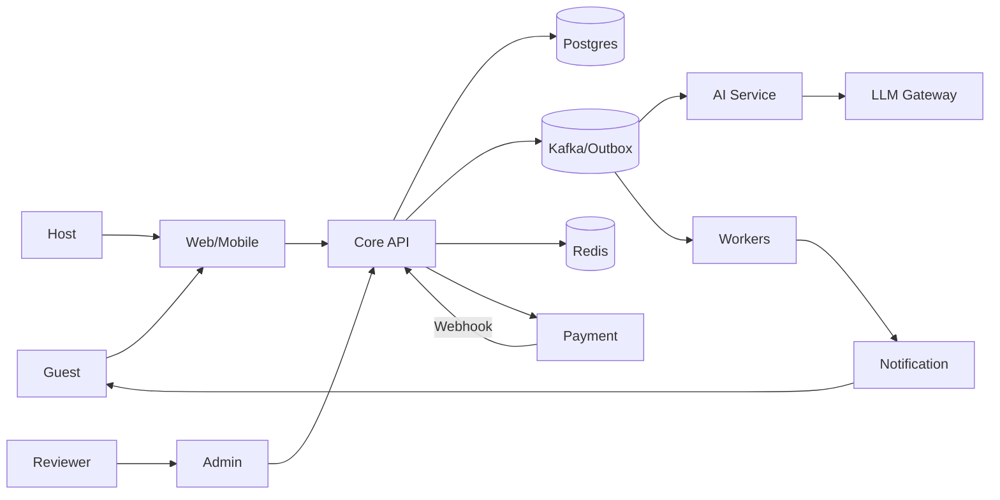

# کیان اقامت — مستند معماری ۰ تا ۱۰۰

## فاز ۰ — اصول حاکم و KPI
| # | اصل | مفهوم اجرایی |
|---|-----|--------------|
| P1 | Human-in-the-loop محدود | دخالت انسان فقط در تأیید پرداخت/فیش و حل اختلاف |
| P2 | Assume-Untrusted | هر ورودی کاربر یا AI اعتبارسنجی + confidence میگیرد |
| P3 | Event-First | تمام تغییرات وضعیت در Event Bus منتشر میشود |
| P4 | Plugin Boundary | هیچ کد مخصوص «اقامت» در core نفوذ نکند |
| P5 | Idempotency by Default | هر رزرو/پرداختclé یکتا دارد |
| P6 | Explainable AI | reason + model_version + confidence در لاگ |

KPI: نرخ خودکارسازی ≥ ۹۰٪، مداخله انسانی < ۰٫۱ per booking، ثبت اقامت < ۳ دقیقه، تایید < ۱۰s، آپتایم ۹۹٫۹۵٪.

## فاز ۱ — تکنولوژی
| لایه | انتخاب | دلیل |
|------|--------|------|
| وب | Next.js 15 + React 19 + TS + Tailwind + shadcn/ui | SSR/SEO + RTL |
| موبایل | Expo / React Native | اشتراک کد |
| Core API | NestJS | DI و ماژولاریتی |
| AI | FastAPI + PyTorch/LightGBM | ابزارML بالغ |
| Worker | Temporal + BullMQ | workflow طولانی + retry |
| DB | Postgres 16 + PostGIS + pgvector | geo + embedding |
| کش | Redis 7 | کش/صف/session |
| جستجو | Meilisearch | فارسی + geo |
| Storage | MinIO/S3 | عکس/مدارک |
| Event | Kafka + Outbox/CDC | at-least-once |
| Observability | OTel + Prometheus + Grafana + Loki + Sentry | یکپارچگی |
| پرداخت | Stripe + دروازه محلی | tokenization، خارج از PCI |
| LLM | LiteLLM | gateway واحد + cost |

ADR: (1) جداسازی core تراکنشی از AI احتمالی؛ (2) pgvector بجای Vector DB جدا؛ (3) Outbox+CDC بجای dual-write؛ (4) RLS + tenant_id.

## فاز ۲ — معماری
### Context (C4 L1)

### لایهها
Interface → Application (Use Cases) → Domain (Core + Plugins) → Infrastructure.

### Multi-Business (مهمترین)
انتزاع سهگانه: **Listing** (هر چیز قابل رزرو)، **Reservation** (رزرو عمومی)، **BusinessModule** (پلاگین قواعد). Core فقط به interface وابسته است. فیلدهای اختصاصی در JSONB + schema پلاگین. جداول اختصاصی از طریق listing_id متصلاند، FK از core به آنها ممنوع. ارتباط پلاگینها فقط via Event.

اضافه کردن کسبوکار جدید: (1) پیادهسازی Module، (2) جدول اختصاصی، (3) registry.register، (4) UI data-driven، (5) Event refresh.

### مقیاسپذیری
Stateless API، HPA، Read replica، ۳ لایه کش، sharding بر tenant_id در >10M، degradation (AI down → rule-based)، SLO 99.95% / p95<300ms، DR با PITR.

## فاز ۳ — دیتابیس
شماتیک: identity.users → catalog.listings → commerce.reservations → commerce.payments + ops.review_tasks + ops.disputes؛ ai.* logs؛ analytics.outbox_events → Kafka.

جزئیات کامل DDL در `db/migrations/0001_init.sql`. نکات: تک stamping با `tstzrange + EXCLUDE` جلوی double-booking را میگیرد؛ `hnsw` для embedding؛ `outbox` جلوی گم شدن event؛ `review_tasks` تنها نقطه انسانی؛ RLS جداسازی tenant.

## فاز ۴ — AI و اتوماسیون
- **Gateway**: LiteLLM با fallback زنجیرهای primary→secondary→rule-based و ثبت cost/latency.
- **Pricing**: LightGBM → Contextual Bandit → RL؛ خروجی suggested/floor/ceiling/reason/confidence؛ guardrail [0.7×base, 2.5×base]؛ cold start ۷ رزرو؛ retrain شبانه + PSI drift.
- **OCR**: Preprocess→PaddleOCR→Cross-check→Fraud heuristics. confidence ≥0.90 auto-approve؛ 0.60–0.90 ربات retry تا ۳ بار؛ <0.60 بدون انسان، دلیل به میزبان. اعتراض = Dispute (نقطه ۲).
- **Chatbot**: RAG + Intent Router + Tool Calling؛ escalation فقط با انتخاب dispute.
- **Recommender**: Two-Tower + pgvector HNSW + LightGBM ranker + diversity + A/B.
- **Schedulerها**: price_refresh 6h، calendar_sync 15m، hold_expiry 1m، review_nudge، payout_run هفتگی، ai_eval روزانه.

## فاز ۵ — Workflows
رزرو: Search→Quote→Held→AwaitingPayment→(Review|Confirmed)→CheckedIn→Completed؛ مسیرهای Cancelled و Disputed.
میزبان: OTP→عکس+متن→AI title/desc/price→OCR→Publish→iCal→Auto-Pricing.
اپراتور: دو صفحه Payment Review و Dispute Resolution.

## فاز ۶ — امنیت و پایداری
STRIDE: OTP+device binding، webhook signature، audit append-only، PII AES-GCM+KMS+RLS، WAF+rate-limit، RBAC+ABAC. PCI: کارتnever وارد سرور نمیشود. Upload: ClamAV + strip EXIF + presigned TTL. Secrets: Vault/SOPS. Compliance: GDPR DSAR توسط ربات.
پایداری: idempotency، retry+backoff+DLQ، circuit breaker، bulkhead، timeout صریح، PITR + DR region.

## فاز ۷ — تست و مشاهدهپذیری
هرم: Unit 70%، Integration 20% (Testcontainers)، Contract (AsyncAPI)، E2E 10% (Playwright)، Property-based، Load k6، Chaos Litmus.
سناریوها: double-booking→409/201، webhook تکراری→یک payment، OCR تار→retry ربات بدون انسان، LLM قطع→fallback، فیش 0.72→review task، طغیان قیمت→guardrail، پلاگین جدید→core testها سبز.
Observability: OTel trace_id در eventها؛ متریک human_touch_rate؛ هشدار >10%.

## فاز ۸ — Roadmap
فاز ۰ (۰–۱۰) CI؛ ۱ (۱–۲۵) first booking؛ ۲ (۲۵–۴۵) auto-publish≥80%； ۳ (۴۵–۶۰) self-service≥90%； ۴ (۶۰–۷۵) 3 پلاگین؛ ۵ (۷۵–۹۰) load test؛ ۶ (۹۰–۱۰۰) go-live.

## فاز ۹ — Scaffold
کدها در `packages/contracts`, `services/ai-service`, `db/migrations`, `infra`.
